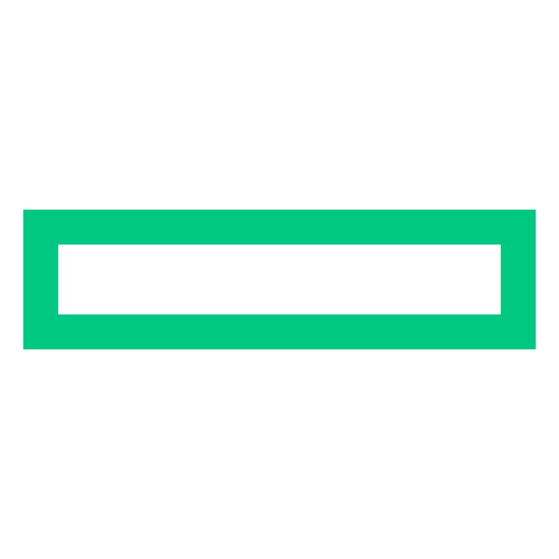
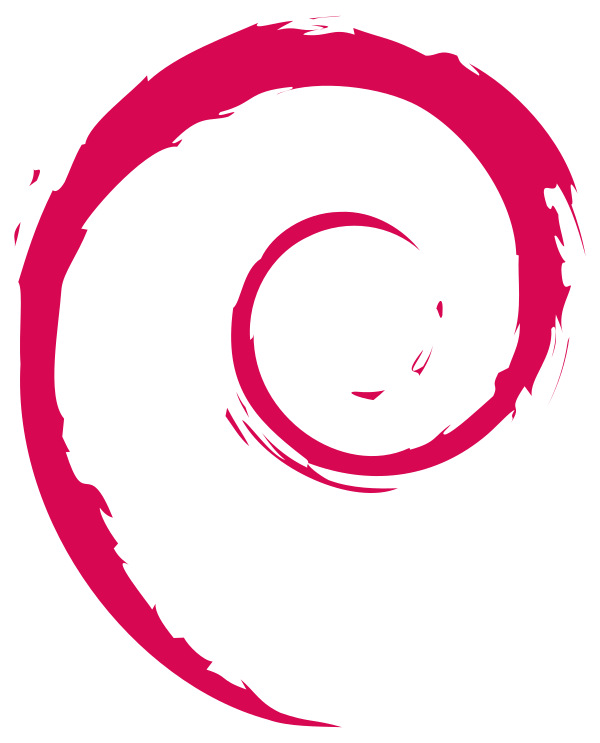
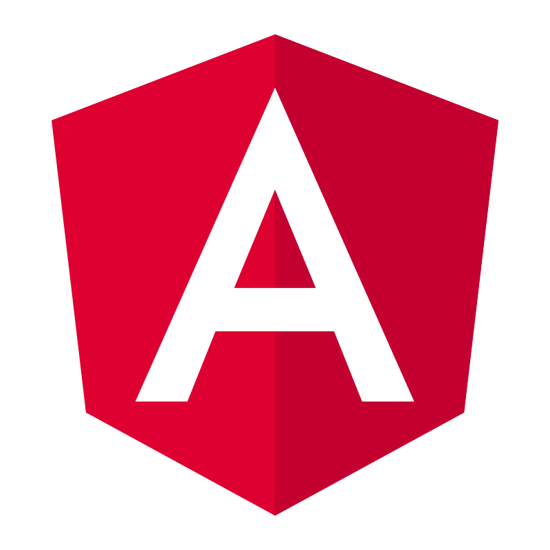
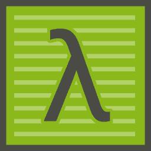
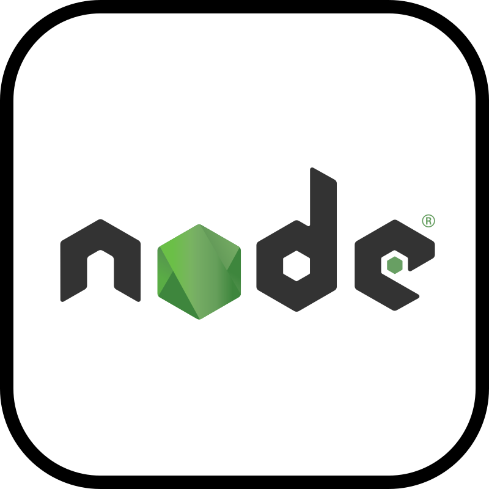
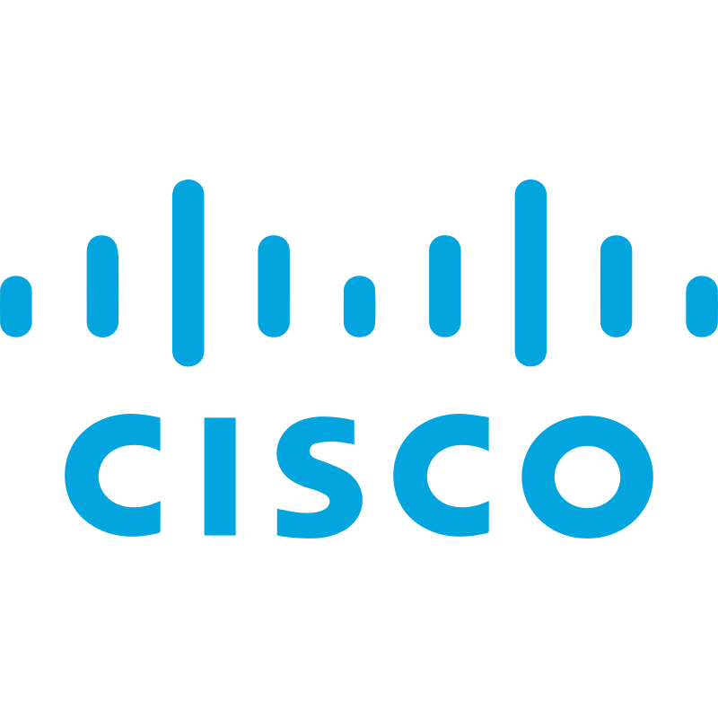
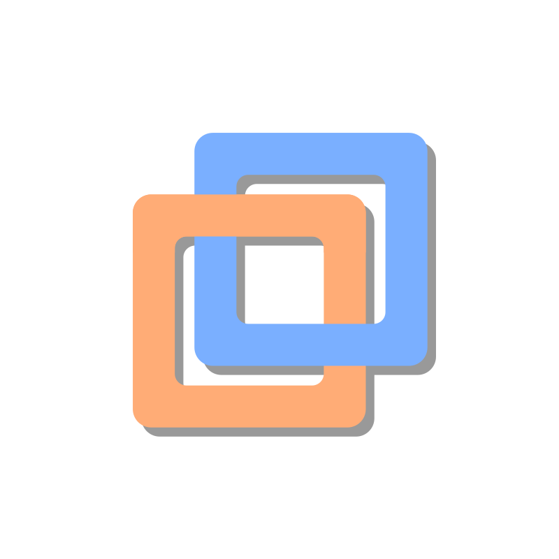
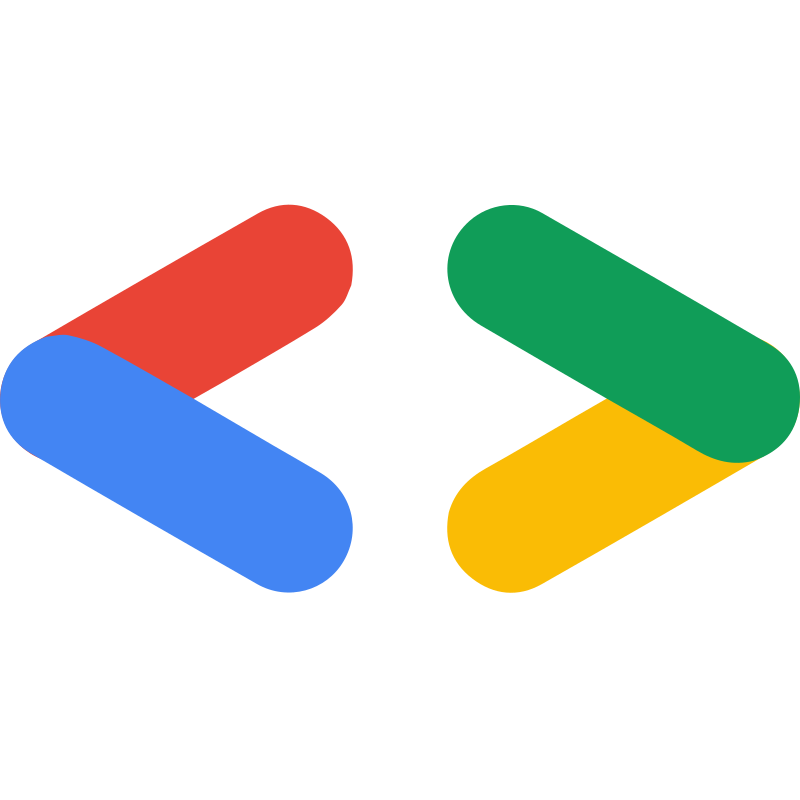

# Hi, I'm Milan — you can call me M. 🦉

## Technology Professional | Product Builder | Systems Thinker

I'm a self-taught technology professional from Nepal with a passion for building practical solutions that improve everyday life.

My journey into technology wasn't conventional. I began my career in hospitality as a Front Office Receptionist, where I naturally gravitated toward solving technical problems. Whether it was troubleshooting computers, networks, or software, I was always eager to learn beyond my role. Through continuous self-learning, hands-on experience, and taking on increasing technical responsibilities, I transitioned into the hotel's IT department and eventually grew into an IT Manager.

Today, I combine my experience in IT operations, software development, and product thinking to create technology that solves real-world problems. I enjoy understanding how people interact with systems, identifying inefficiencies, and designing solutions that are simple, scalable, and meaningful.

I'm currently building **Khaancho**—a next-generation classified advertising platform—and continuously exploring AI-assisted software development, automation, and modern web technologies.

> *"I believe technology should simplify life, empower people, and solve problems that truly matter."*

---

## 🚀 What I'm Working On

- 🛠 Building **Khaancho** — A next-generation classified advertising platform.
- 💻 Developing full-stack web applications.
- 🤖 Exploring AI-assisted software development.
- 📚 Creating knowledge management systems and technical documentation.
- ⚙️ Improving business processes through technology.

---

## 💡 Philosophy

> Technology should solve real problems, not create unnecessary complexity.

I believe software should be:

- Useful
- Simple
- Maintainable
- Human-centered
- Built for long-term value

---

## 🧠 Skills

### Software Development

- Full Stack Web Development
- REST APIs
- Database Design
- System Architecture
- Software Debugging

### Product

- Product Strategy
- MVP Planning
- Systems Thinking
- Business Analysis
- UX-Oriented Problem Solving

### AI

- Prompt Engineering
- AI-Assisted Development
- Workflow Automation
- Knowledge Base Development

### Professional

- Technical Documentation
- Project Planning
- Process Improvement
- Critical Thinking
- Continuous Learning

---

## 💼 Experience

### IT Officer
*Current*

- IT Operations
- Technical Support
- Knowledge Base Management
- Process Automation
- System Administration

### Front Office Receptionist
**Hotel Nature**

- Guest Relations
- Reservation Management
- Customer Service
- Cross-department Coordination

### Cable TV System Technician
**Nexus Pvt. Ltd.**

- Satellite TV Installation
- CATV / SMATV Systems
- RF Signal Troubleshooting
- Technical Field Support

---

## 🌱 Current Learning

- Software Architecture
- Scalable System Design
- AI Engineering
- Product Management
- Cloud Technologies

---

## 📌 Featured Projects

### Khaancho
A modern classified advertising platform designed to simplify buying, selling, and local discovery.

**Focus Areas**

- Product Design
- Marketplace Systems
- User Experience
- AI Integration
- Scalable Architecture

---

### Kamana Code

Building software with a philosophy:

> Think. Code. Build.

---

### Squarespace Web Designer

Custom Squarespace websites for hospitality brands, small businesses, and creators —
from layout and brand system to launch and handover.

**What I deliver**

- Site builds on Squarespace 7.1
- Custom CSS, layout, and brand-aligned design systems
- Third-party integrations (forms, scheduling, payments, email)
- Content migration, SEO setup, and launch handover

---

## 📈 Goals

- Build products that positively impact millions of people.
- Create scalable technology businesses.
- Contribute to open-source projects.
- Continue learning every day.

---

## 📫 Connect

- GitHub: https://github.com/milanshrestha

---

> *"Build technology that people genuinely need."*

---

> Tools, languages, and other things that I use!

  <figure style="margin:0; text-align:center; width:96px;">
    
    <figcaption style="font-size:12px; margin-top:6px;">Dell</figcaption>
  </figure>

  <figure style="margin:0; text-align:center; width:96px;">
    
    <figcaption style="font-size:12px; margin-top:6px;">HPE</figcaption>
  </figure>

  <figure style="margin:0; text-align:center; width:96px;">
    
    <figcaption style="font-size:12px; margin-top:6px;">Thinkpad</figcaption>
  </figure>

  <figure style="margin:0; text-align:center; width:96px;">
    
    <figcaption style="font-size:12px; margin-top:6px;">Debian</figcaption>
  </figure>

  <figure style="margin:0; text-align:center; width:96px;">
    
    <figcaption style="font-size:12px; margin-top:6px;">OpenBSD</figcaption>
  </figure>

  <figure style="margin:0; text-align:center; width:96px;">
    
    <figcaption style="font-size:12px; margin-top:6px;">Ubuntu</figcaption>
  </figure>

  <figure style="margin:0; text-align:center; width:96px;">
    
    <figcaption style="font-size:12px; margin-top:6px;">11ty</figcaption>
  </figure>

  <figure style="margin:0; text-align:center; width:96px;">
    
    <figcaption style="font-size:12px; margin-top:6px;">Angular</figcaption>
  </figure>

  <figure style="margin:0; text-align:center; width:96px;">
    
    <figcaption style="font-size:12px; margin-top:6px;">Cmder</figcaption>
  </figure>

  <figure style="margin:0; text-align:center; width:96px;">
    
    <figcaption style="font-size:12px; margin-top:6px;">ExpressJS</figcaption>
  </figure>

  <figure style="margin:0; text-align:center; width:96px;">
    
    <figcaption style="font-size:12px; margin-top:6px;">Laragon</figcaption>
  </figure>

  <figure style="margin:0; text-align:center; width:96px;">
    
    <figcaption style="font-size:12px; margin-top:6px;">MongoDB</figcaption>
  </figure>

  <figure style="margin:0; text-align:center; width:96px;">
    
    <figcaption style="font-size:12px; margin-top:6px;">NodeJS</figcaption>
  </figure>

  <figure style="margin:0; text-align:center; width:96px;">
    
    <figcaption style="font-size:12px; margin-top:6px;">Squarespace</figcaption>
  </figure>

  <figure style="margin:0; text-align:center; width:96px;">
    
    <figcaption style="font-size:12px; margin-top:6px;">VSCode</figcaption>
  </figure>

  <figure style="margin:0; text-align:center; width:96px;">
    
    <figcaption style="font-size:12px; margin-top:6px;">Web.Dev</figcaption>
  </figure>

  <figure style="margin:0; text-align:center; width:96px;">
    
    <figcaption style="font-size:12px; margin-top:6px;">Cisco</figcaption>
  </figure>

  <figure style="margin:0; text-align:center; width:96px;">
    
    <figcaption style="font-size:12px; margin-top:6px;">Fortinet</figcaption>
  </figure>

  <figure style="margin:0; text-align:center; width:96px;">
    
    <figcaption style="font-size:12px; margin-top:6px;">Mikrotik</figcaption>
  </figure>

  <figure style="margin:0; text-align:center; width:96px;">
    
    <figcaption style="font-size:12px; margin-top:6px;">VMware</figcaption>
  </figure>

  <figure style="margin:0; text-align:center; width:96px;">
    
    <figcaption style="font-size:12px; margin-top:6px;">Dev.Google</figcaption>
  </figure>

